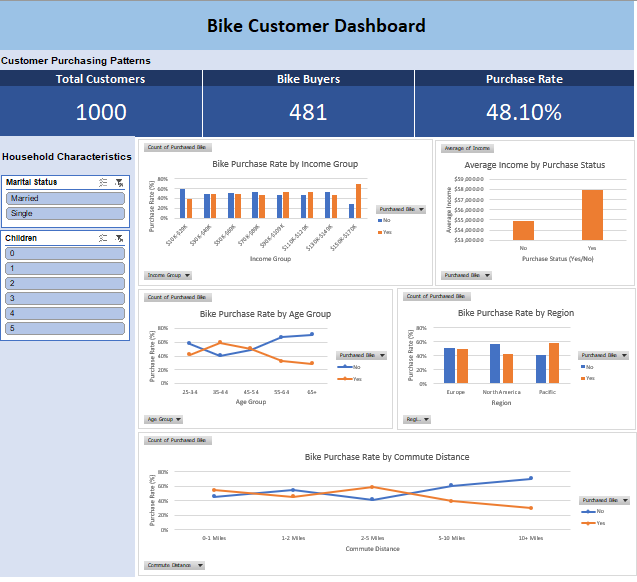

# Bike Customer Data Cleaning & Purchasing Analysis
This project explores customer purchasing patterns to identify characteristics associated with bike purchases. The analysis was conducted using Microsoft Excel to clean and validate customer data, create PivotTables, and develop an interactive dashboard to communicate key findings and business recommendations.

## Dataset
The dataset contains customer demographic, household, income, and commuting information, including:
- Marital status and number of children
- Income
- Gender and age
- Education and occupation
- Home ownership and number of cars
- Commute distance and region
- Bike purchase status: Yes/No
The original dataset contained 1,026 records. After removing 26 duplicate records, the cleaned dataset contained 1,000 records.

## Business Questions
What customer characteristics are associated with bike purchasing? Which customer segments have the highest purchase rates?
- 1. **Age:** Which age groups have the highest bike purchase rate?
- 2. **Income:** How does income relate to purchase rate? Do customers who purchased a bike have a different average income from customers who did not?
- 3. **Commute Distance:** Does commute distance relate to the purchase rate?
- 4. **Region:** How does bike purchase rate vary by region?

## Tools and Skills Used
- `Microsoft Excel`
- Data cleaning and standardization
- Duplicate detection and removal
- Excel Tables and structured references
- Excel formulas, including `IFS`, `COUNTIF`, and `COUNTA`
- `PivotTables`
- `PivotCharts` and interactive slicers
- KPI cards and dashboard design 

## Data Cleaning and Preparation
- Identified and removed 26 duplicate records.
- Standardized marital status values from abbreviated categories (M/S) to descriptive labels.
- Standardized gender values from abbreviated categories (F/M) to descriptive labels.
- Created age and income groups using Excel formulas to support customer segment analysis.

## Analysis and Dashboard
PivotTables and charts were used to analyze customer purchasing patterns across different segments.
The dashboard includes:
- **KPI cards:** Total customers, bike buyers, and overall purchase rate.
- **Bike Purchase Rate by Age Group:** Compares bike purchasing rates across five age categories.
- **Bike Purchase Rate by Income Group:** Examines purchasing patterns across eight income categories.
- **Average Income by Purchase Status:** Compares average income between customers who purchased a bike and those who did not.
- **Bike Purchase Rate by Commute Distance:** Compares purchase rates across commuting distances.
- **Bike Purchase Rate by Region:** Examines regional differences in purchasing patterns.

The dashboard also includes `Marital Status` and `Children` slicers to explore how bike purchasing patterns vary across different household characteristics.

## Key Findings
- **Overall Performance:** Of the 1,000 customers in the cleaned dataset, 481 purchased a bike, resulting in an overall purchase rate of 48.1%.
- **Age:** Customers aged 35-44 had the highest bike purchase rate among the age groups, at 60%.
- **Income:** Customers who purchased bikes had a higher average income than customers who did not. The $150K-$170K income group had the highest purchase rate at 70%. However, the $150K-$170K group contained only 10 customers, so its purchase rate should be interpreted carefully.
- **Commute Distance:** Customers with a commute distance of 2-5 miles had the highest purchase rate at 59%, while customers commuting 10+ miles had the lowest rate at 30%.
- **Region:** The Pacific region had the highest purchase rate at 59%, while North America had the lowest at 43%.

## Recommendations
- Use the purchasing patterns observed among customers aged 35-44 and customers in the Pacific region to develop targeted marketing campaigns. Test different promotions and track purchase rates before expanding these strategies.
- Explore whether customers with shorter commutes prefer certain bike types, price points, or features. Use these insights to inform product recommendations and promotions tailored to different commuting needs.	
- Investigate the purchasing behavior of higher-income customers, particularly the $150K-$170K group. Since this segment contains only 10 customers, analyze a larger sample before making marketing investment decisions based on its 70% purchase rate.	

## Excel dashboard
